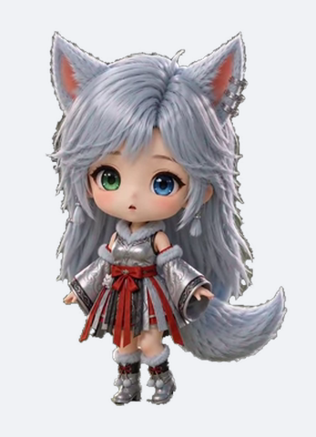
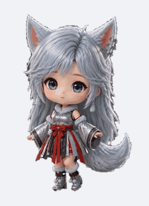
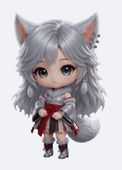
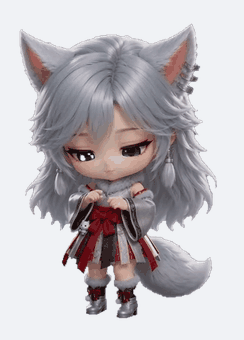

<div align="center">



# 银月 · Yinyue

**一只住在 DeepSeek Harness 里的银发狐耳少女**

[](LICENSE)
[](https://github.com/PC2005-cloud/dsh-pet)
[](docs/ANIMATIONS.md)

</div>

> 银发、狐耳、异色瞳（左绿右蓝）、一条毛茸茸的大尾巴。
> 安静，温和，有点小骄傲 —— 你干活的时候她就在旁边待着，偶尔抬眼看一下。

---

## 这是什么

这是一个 **pet pack（宠物素材包）**，不是插件。

它给 [dsh-pet](https://github.com/PC2005-cloud/dsh-pet) 插件添加一个全新宠物「种类」——
独立的三套动画 + 独立配置，和插件自带的主宠物严格隔离、互不干扰。

装好之后你可以：

- 让银月住在桌面（透明置顶小窗）或浏览器里，或者两边都有
- 点击她，她会挥手回应
- AI 在干活时，她切到「工作中」动画，配一句状态气泡
- 同时养多只（每只独立大小和位置）

## 预览

| 待机 | 点击回应 | 工作中 |
|:---:|:---:|:---:|
|  |  |  |
| 9.96 s · 循环 | 3.29 s · 单次 | 3.83 s · 循环 |

## 安装

### 前置条件

先装好 **dsh-pet** 插件（银月只是给它的素材，没有插件不会动）：

- 桌面版：DeepSeek Harness 应用内「插件管理」→ 安装 `dsh-pet`
- 命令行：`dsh plugin --profile desktop add dsh-pet`

要求 dsh-pet **≥ 0.3.8**（pet pack 的校验规则在这个版本定型）。

### 方式一：一键脚本（推荐）

```bash
git clone https://github.com/<your-github-name>/dsh-pet-yinyue.git
cd dsh-pet-yinyue
python install.py
```

脚本会自己找到 DSH 数据目录、检查插件版本、复制素材、校验配置合法性。

```bash
python install.py --dry-run    # 先看看会做什么，不写盘
python install.py --verify     # 只检查已装的那份
python install.py --uninstall  # 卸载
```

只依赖 Python 3.7+ 标准库，Windows / macOS / Linux 通用。

### 方式二：手动复制

把 `pet/` 目录下的东西整个放进 DSH 的 pet 目录：

**Windows**

```powershell
xcopy pet "%USERPROFILE%\.dsh\dsh-pet\pet" /E /I /Y
```

**macOS / Linux**

```bash
mkdir -p ~/.dsh/dsh-pet/pet
cp -r pet/* ~/.dsh/dsh-pet/pet/
```

装完的结构应该是这样：

```
~/.dsh/dsh-pet/pet/
├── yinyue-config.json
└── yinyue-animation/
    ├── 待机.webm
    ├── 回应-挥手.webm
    └── 工作中.webm
```

> 设置了 `DSH_HOME` 环境变量的话，把 `~/.dsh` 换成 `$DSH_HOME`。

### 生效

- **浏览器**：刷新 DSH 页面
- **桌面窗口**：在任意宠物上右键 →「重载配置」，或重启 DeepSeek Harness

装好后在宠物右键菜单里就能选到她，右键 →「显示位置」可以切换桌面/网页/两者/都不。

## 配置

配置文件是 `pet/yinyue-config.json`，和 dsh-pet 的配置**完全同构**。
装好之后想改，改 `~/.dsh/dsh-pet/pet/yinyue-config.json`，刷新页面生效。

最常改的几个：

```jsonc
"pets": [
  {
    "id": "yinyue",        // 实例 id，和别人重名会冲突，建议保留
    "name": "银月",         // 显示名，随便改
    "size": 420,           // 宽度 px，越大越占地方
    "display": "both",     // web / desktop / both / none
    "position": { "corner": "top-right", "marginX": 24, "marginY": 100 },
    "whisperEnabled": false,    // 碎碎念（会调模型，费 token）
    "workStatusEnabled": true,  // AI 干活时的状态气泡
    "balanceEnabled": false     // 余额档位动画（银月没做余额动画，建议保持 false）
  }
]
```

`whisperPrompt` 是人设，想换个性格直接改那段文字就行。

更多字段（物理参数、字体、刷新周期…）见 dsh-pet 的
[配置文档](https://github.com/PC2005-cloud/dsh-pet#-配置)。

动画清单和素材规范见 [docs/ANIMATIONS.md](docs/ANIMATIONS.md)。

## 卸载

```bash
python install.py --uninstall
```

或者手动删掉这两个：

```
~/.dsh/dsh-pet/pet/yinyue-config.json
~/.dsh/dsh-pet/pet/yinyue-animation/
```

不会动 dsh-pet 插件本体，也不会影响其他宠物。

## 常见问题

**装好了但看不到她？**

先看 dsh-pet 是否真的加载了这份配置：

```bash
cd ~/.dsh/profiles/desktop/node_modules/dsh-pet
node lib/standalone.js --check
```

输出里应该能看到 `条目 yinyue：宠物 1 只 yinyue(...)`。没有的话，检查目录层级
（必须是 `pet/yinyue-config.json`，不能多套一层文件夹）。

**她变成黑底方块了？**

素材必须是 **VP9 + Alpha** 编码。如果你自己替换了动画，确认编码正确 ——
普通 VP9 没有 alpha 通道，桌面窗口里就会是黑底。

**点了她不挥手？**

`clicks` 池里只有「回应-挥手」一个动画。检查 `pet/yinyue-animation/回应-挥手.webm`
是否存在、文件名是否完全一致（中文名，含连字符）。

**能和插件自带的宠物一起养吗？**

能，完全隔离。银月的素材只从 `pet/yinyue-animation/` 读，绝不会去拿主宠物的动画，
反过来也一样。多只在设置页「桌宠配置」里各自调大小和位置。

**设置页「桌宠配置」里找不到她？**

这是 dsh-pet 的设计：设置页只列出主宠物条目（`main-config.jsonc`），
pet pack 的宠物不在那个列表里。银月的开关和位置用**右键菜单**管，或者直接改配置文件。

## 授权

素材以 **[CC BY-NC 4.0](LICENSE)** 授权 —— 你可以自由使用、修改、再分发，
但**不能用于商业目的**，并且需要署名。

转载或二次创作时请保留：

```
银月 · Yinyue — https://github.com/<your-github-name>/dsh-pet-yinyue
Licensed under CC BY-NC 4.0
```

## 致谢

- [dsh-pet](https://github.com/PC2005-cloud/dsh-pet) — MIT，PC2005-cloud。没有它就没有这套东西
- [DeepSeek Harness](https://github.com/deepseek-ai/deepseek-harness) — 宿主应用

## 声明

角色形象与动画由 AI 视频生成工具制作，经绿幕抠像、尺寸归一化与 VP9 Alpha 编码处理。
发布者不对角色形象主张独占权利，仅对本仓库中的整理、抠像与配置工作主张署名。
如果权利人认为存在侵权，请开 issue 联系，会及时处理。
